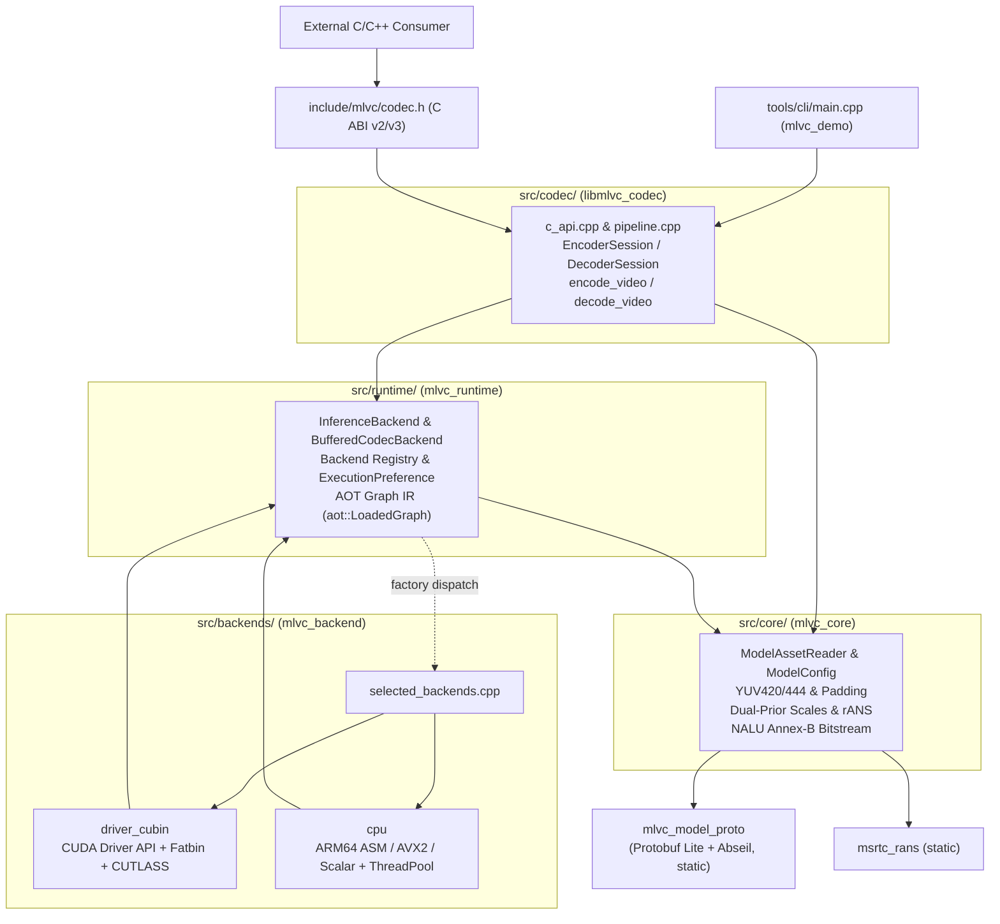

# System Architecture

`mlvc.cpp` separates portable codec algorithms, backend-agnostic graph contracts, platform-specific inference backends, and public API surfaces into four internal layers plus a minimal installed C header.

## Layered Overview



### Design Invariants

1. **Strict public ABI isolation**: Only [`include/mlvc/codec.h`](../include/mlvc/codec.h) is installed. Core, runtime, backend, CUDA, CUTLASS, Protobuf, and Abseil headers remain private. On ELF targets, [`cmake/codec.exports.map`](../cmake/codec.exports.map) hides all third-party and internal implementation symbols.
2. **One-way dependency graph**:
   - `src/core` depends only on `msrtc_rans` and `mlvc_model_proto` (no backend, no GPU/CPU execution code).
   - `src/runtime` depends on `src/core` and `mlvc_model_proto`, defining the AOT IR and backend contracts without knowing which backends are compiled.
   - `src/backends/*` implement `src/runtime` interfaces and register factories via `src/backends/selected_backends.cpp`.
   - `src/codec` composes `src/core` + `src/runtime` into frame-level sessions and streaming file/FIFO entry points, independent of any concrete backend header.
3. **No runtime framework or JSON parser**: All model metadata, PMF tables, graph schedules, and manifests are binary Protobuf messages parsed through statically linked Protobuf Lite. `tools/python/mlvc_tools/profiles.json` is consumed only by offline Python tooling.

---

## Core Abstractions

### 1. Model Asset Loading (`src/core/assets.hpp`)

`ModelAssetReader` decouples model parsing from storage layout:

```cpp
class ModelAssetReader {
public:
    virtual ~ModelAssetReader() = default;
    virtual std::string location_label() const = 0;
    virtual bool exists(const std::filesystem::path& relative_path) const = 0;
    virtual std::vector<std::byte> read_binary(
        const std::filesystem::path& relative_path) const = 0;
};
```

Built-in factories resolved by `resolve_model_asset_reader(model_dir, override_reader)`:

- **Override reader**: Callers using the internal C++ API can inject custom readers (for example, Android `AAssetManager` or memory-mapped archives) directly through `SessionOptions::asset_reader` / `BackendOptions::asset_reader`.
- **Embedded reader (`embedded:<profile>`)**: Reads directly from the `.incbin` read-only section linked into `mlvc_core` when built with `MLVC_EMBED_MODELS=ON`. When `model_dir` is omitted in an embedded build, `default_model_location()` resolves to `embedded:mlvc-psnr-v1`.
- **Directory reader**: Reads canonical bundle files (`metadata.pb`, `gaussian_pmf.pb`, `bit_estimator_pmf.pb`, `aot/MLVCEncoder/{graph.pb,weights.bin}`, `aot/MLVCDecoder/{graph.pb,weights.bin}`) from a filesystem directory.

### 2. Backend Contract & Registry (`src/runtime/backend.hpp`)

Every inference backend implements `InferenceBackend`:

- `load(model_name, ModelExecutionConfig)`: Loads `MLVCEncoder` or `MLVCDecoder`, validates shapes/types, plans buffers, and binds recurrent state loops (`StateTensorBinding`).
- `run(inputs)`: Executes one synchronous forward pass. State tensors declared in `state_bindings` are excluded from host-visible inputs and outputs.
- `reset_state()`: Zeroes bound recurrent feature tensors at GOP / IDR boundaries.

Backends that maintain persistent frame buffers and fused YUV conversion also implement `BufferedCodecBackend`:

- `configure_codec_io(CodecIoConfig)` allocates `slots` (default 2) persistent frame slots.
- Encoder fast path: `encoder_input_yuv(slot)` → `submit_encoder(slot, shifted_q)` → `wait_codec_slot(slot)` → `encoder_outputs(slot)`.
- Decoder fast path: `decoder_inputs(slot)` → `submit_decoder(slot, shifted_q)` → `wait_codec_slot(slot)` → `decoder_output_yuv(slot)`.

Both `driver-cubin` and `cpu` implement both `InferenceBackend` and `BufferedCodecBackend`.

#### Compile-Time Selection & Runtime Dispatch

`MLVC_BACKEND` controls which backends are linked into `mlvc_backend`:

| `MLVC_BACKEND` | Registered Backends                                            | Default Backend  |
| -------------- | -------------------------------------------------------------- | ---------------- |
| `AUTO`         | `driver_cubin` on Linux `x86_64`; `cpu` on all other platforms | Resolved backend |
| `driver_cubin` | `driver-cubin` (Linux `x86_64` only)                           | `driver-cubin`   |
| `cpu`          | `cpu`                                                          | `cpu`            |
| `all`          | `driver-cubin`, `cpu` (Linux `x86_64` only)                    | `driver-cubin`   |
| `none`         | *(none)* — portable core/bitstream/C ABI build                 | `none`           |

At runtime, `create_backend(BackendOptions)` resolves the requested `backend_name` (or the registered default when empty) and enforces `ExecutionPreference` (`kAuto`, `kCpu`, `kGpu`, `kNpu`) and `allow_cpu_fallback`.

### 3. Sessions & Pipelines (`src/codec/pipeline.hpp`)

`src/codec/` splits frame-level codec state from file/stream I/O:

- **`EncoderSession` / `DecoderSession`**: File-I/O-free, move-only C++ classes holding the model config, entropy coder, bitstream encoder/decoder, inference backend, and GOP/DPB state. Callers push/pull `Yuv420FrameView` and `EncodedFrame` per frame without touching disk.
- **`encode_video(CodecOptions)` / `decode_video(CodecOptions)`**: Streaming wrappers built on top of the sessions. They read/write YUV420 frames and `mlvc-nalu-v0` Access Units over files, stdin/stdout (`-`), or POSIX named FIFOs, using the double-buffered `BufferedCodecBackend` overlap path whenever `--debug-dir` is disabled.
- **Public C ABI (`src/codec/c_api.cpp`)**: Wraps `encode_video` / `decode_video` and stateful `EncoderSession` / `DecoderSession` with ABI-versioned structs (v2 backward-compatible plus v3 status codes, custom asset readers, logging callbacks, and zero-disk frame sessions), translating all C++ exceptions into status codes and NUL-terminated error strings.

---

## Source Tree Map

```text
include/mlvc/codec.h            Installed public C ABI v2/v3 header
src/
  core/                         Model metadata, SHA-256, logging, ModelAssetReader (mmap/rodata), Tensor/FP16, YUV, scales, rANS, NALU bitstream
  runtime/                      Shared AOT graph loader/IR (aot_graph.*), InferenceBackend & backend registry
  backends/
    selected_backends.cpp       Static registration glue for compiled backends
    driver_cubin/               Dynamic CUDA Driver API wrapper, fatbin kernels, CUTLASS, CUDA Graph executor
    cpu/                        Modular FP16 CPU executor (execution_plan, codec_io, weight_cache, aligned_buffer), ARM64 ASM / AVX2 / scalar kernels, CpuThreadPool
  codec/                        EncoderSession, DecoderSession, file/FIFO pipeline, C ABI implementation
  proto/mlvc_model.proto        Shared Python/C++ Protobuf Lite schema
tools/
  cli/                          mlvc_demo command-line tool (pure public C ABI consumer)
  python/mlvc_tools/            Offline checkpoint AOT compiler, Protobuf bundler, reference generator, profiles.json
  scripts/                      bootstrap.sh, dependencies.env, package.sh
cmake/                          Dependencies, Protobuf build, binary/model embedding, symbol export map, CMake config
tests/
  unit/                         C++, C, and Python unit tests (with shared test_support.hpp)
  fuzz/                         libFuzzer harnesses for bitstream, AOT graph, and entropy decoders
  conformance/                  AOT eager conformance and end-to-end codec compatibility runners
  integration/cmake_consumer/   Installed package CMake/C consumer verification
third_party/                    Pinned submodules (mlvc, cutlass, protobuf, abseil) and libmlvc attribution
models/                         Local git-ignored workspace for canonical bundles and reference test fixtures
```

## Related Documentation

- [Inference Backends](backends.md) — deep dive into `driver-cubin` and `cpu`.
- [Codec Pipeline & Bitstream](codec-and-bitstream.md) — frame loop, entropy coding, and NALU format.
- [Model Pipeline & Binary Format](model-pipeline.md) — offline compilation and Protobuf contracts.
- [SDK Integration Guide](sdk-integration.md) — consuming `libmlvc_codec` from C/CMake and C++.
